# EDA findings

Source: `data/train_test.csv` only (48,000 labelled loads, 1 Jan – 31 Oct 2025). `data/validation.csv` was not opened. Full analysis and code: [`notebooks/01_eda.ipynb`](../notebooks/01_eda.ipynb). Figures: [`reports/figures/eda/`](figures/eda/).

Several findings compare a load's price with its **expected price**: what loads with the same distance, equipment, weight, cities, market index and date typically cost. The expected price comes from a simple regression on log price, used purely as a measuring tool.

## The data at a glance

- Every calendar day from 1 Jan to 31 Oct 2025 has loads (115–198 a day). There are no duplicates, and `load_id` is just a counter in date order.
- There are three clean equipment labels: Dry Van 57%, Reefer 25%, Flatbed 18%.
- 64 cities form 4,014 of the 4,032 possible lanes. A typical lane has about 10 loads; some have only 1.

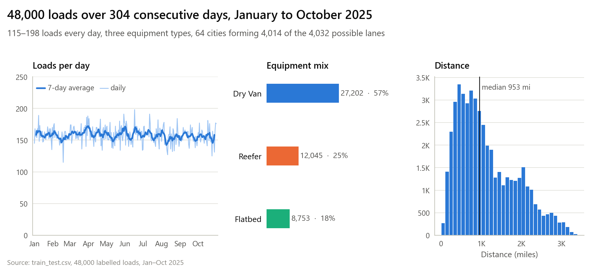

## Data-quality issues

About 6% of loads have at least one problem. Each problem is spread evenly across the months, so they look like random recording errors rather than a change in the market or the process.

| Issue | Loads | What the evidence shows |
|---|---|---|
| **Posted rate off by 2–6×** | 677 (1.4%) | Half too high, half too low, and cleanly separated: every other load sits within 0.92–1.11× of its expected price. These labels are unreliable. |
| Weight capped at 47,500 lb | 1,204 (2.5%) | Heavier loads recorded as the cap; they price like the heaviest uncapped loads, so little information is lost |
| Negative weight | 292 (0.6%) | Sign flip: the absolute value prices exactly like a normal weight |
| Market index missing | 374 (0.8%) | Random; the index is mostly a daily value, so the same day's loads carry it |
| Weight missing | 300 (0.6%) | Random; these loads price like average loads |
| Distance at 70-mile floor | 48 (0.1%) | Very short lanes clamped |
| Weight at 5,000 lb floor | 32 (0.1%) | Light loads clamped |

Stated distance agrees with the coordinates: it is about 1.18 × the straight-line distance between pickup and delivery, plus a little noise per load.

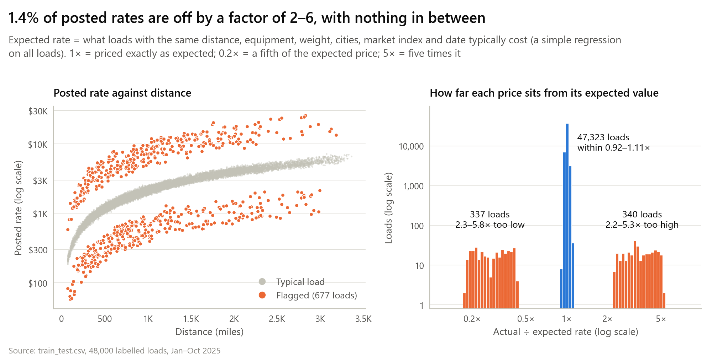
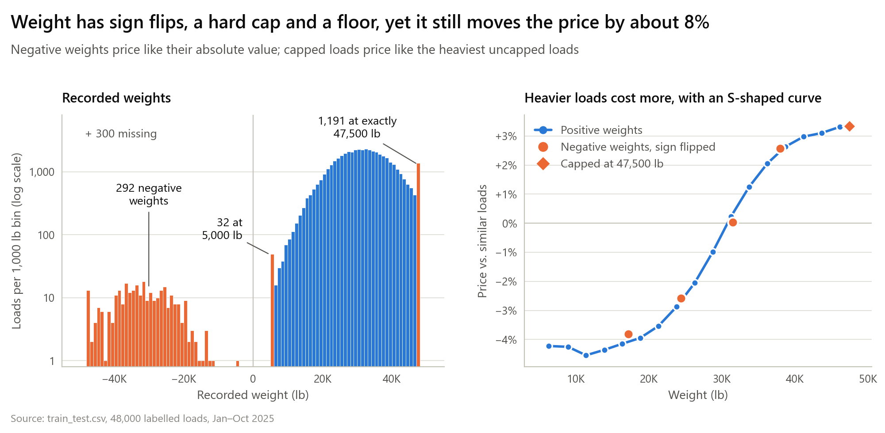
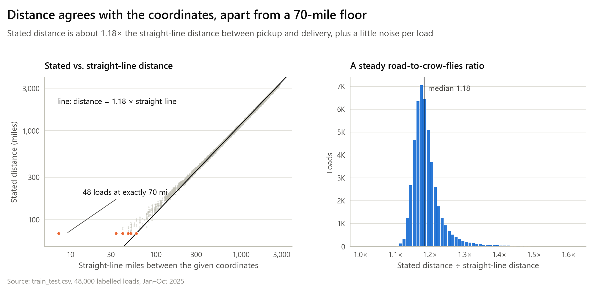
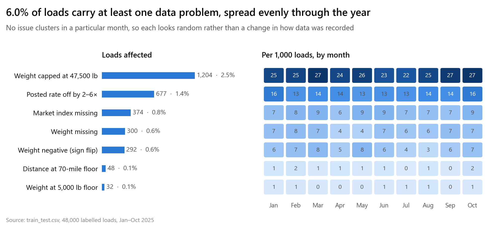

## What drives the price

1. **Distance** dominates: on its own it explains about 99% of the variation in log price. Pricing behaves like a fixed charge (≈ $250) plus a per-mile rate (≈ $1.75–2.00), so short hauls cost more per mile.
2. **Equipment** adds a constant *percentage* at every distance: Reefer +13%, Flatbed +8% over Dry Van.
3. **Weight** adds up to ~8%, on an S-shaped curve: flat below 20K lb, steep from 20K to 40K, flat above. The curve is the same for all equipment types.
4. **Location** shifts price by up to ±4%: Texas/Oklahoma cities are pricier, Northeast/Great Lakes cities cheaper. A city has the same effect whether it is the origin or the destination (r = 0.99), and neighbouring cities price alike. On top of the two city effects, individual lanes deviate by about ±0.9%.
5. **`market_index`** tracks the market's daily price level: a ~10% seasonal swing, sudden steps (up in mid-April, down in late July) and a weekly cycle.
6. **Calendar:** two patterns remain after the market index.
   - A steady upward drift of about +0.6% a month (+6% over the period).
   - **A ramp over the last five weeks of every quarter, accelerating into the last day and resetting the next day.** It looks identical in March, June and September; month-ends outside that window show nothing. Its size depends on equipment: on a quarter's last day, **Dry Van +2.4%, Reefer +5.1%, Flatbed +8.1%**.

   The ~2% weekday cycle (Thursday highest, Sunday lowest) is mostly captured by the market index.
7. **`quote_signal`** is weak and unstable. Price moves only ~2% between its lowest and highest tenth of loads. Its link to price switches on and off from month to month: clearly positive in January–March, June and September, absent in April, May, July and August, and reversed in October. It shows no link to the corrupted prices, so it is not leaking the label.
8. **Noise:** about 1.8% of the price is left unexplained, and that percentage is the same at every distance. Errors therefore scale with the price itself.

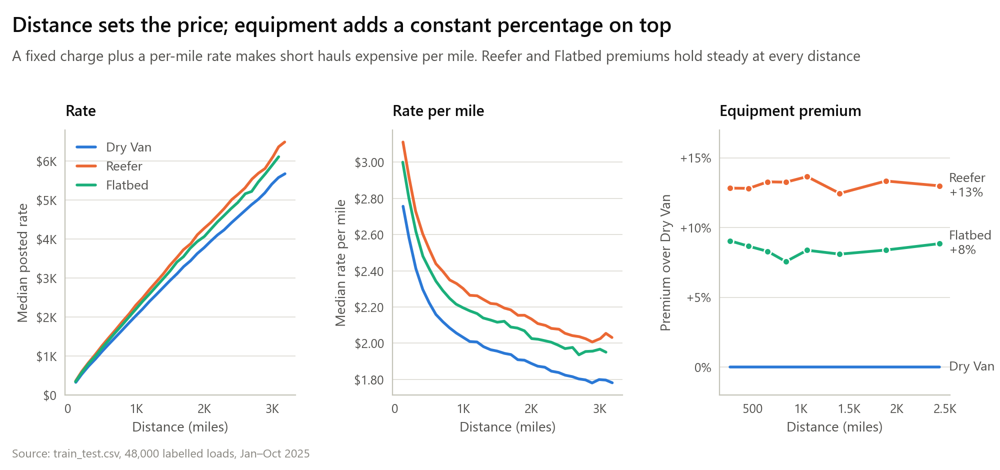
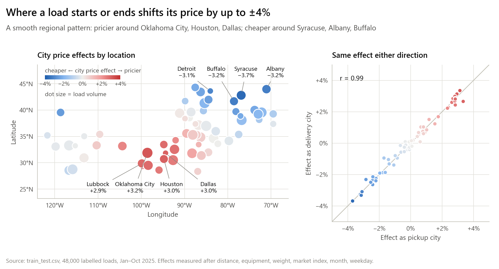
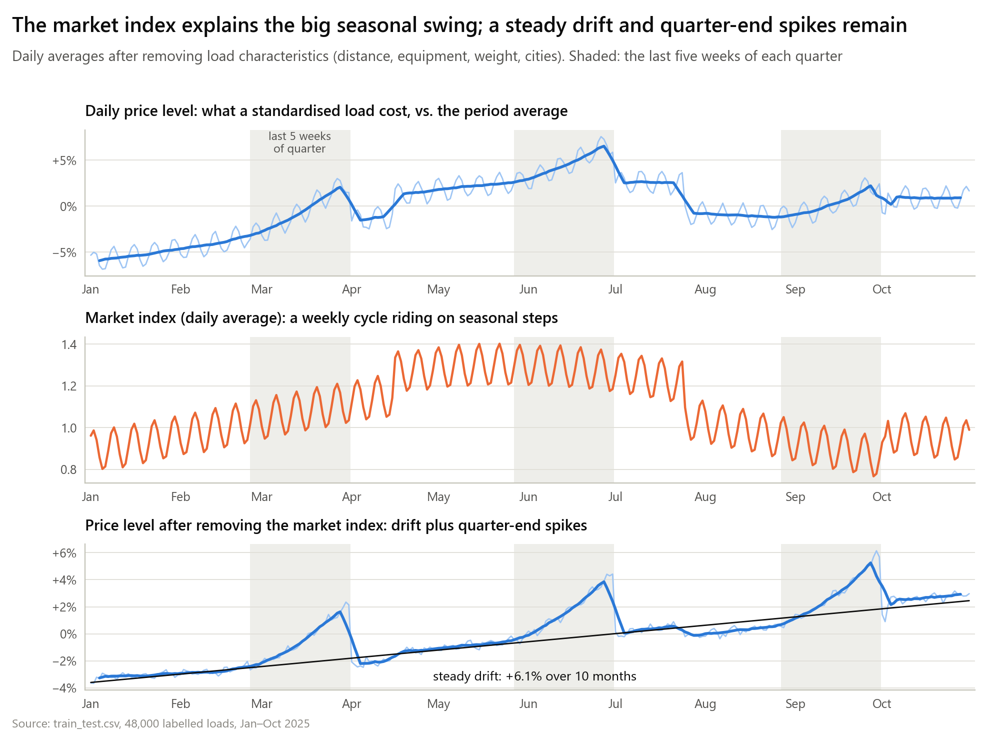
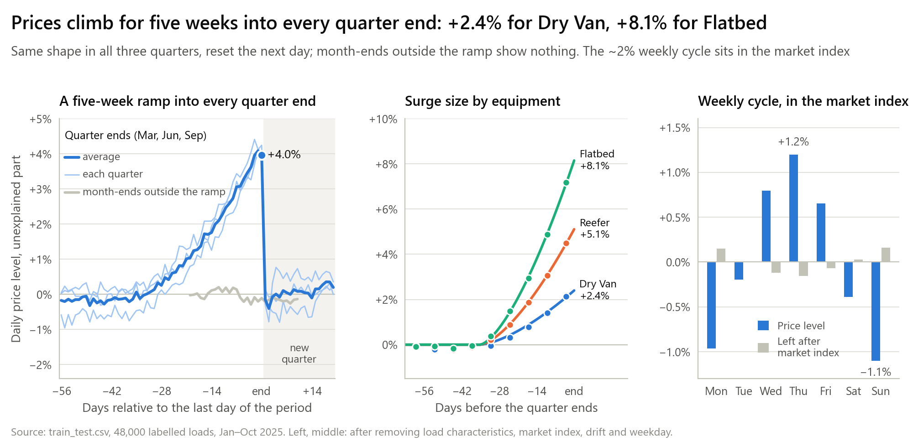
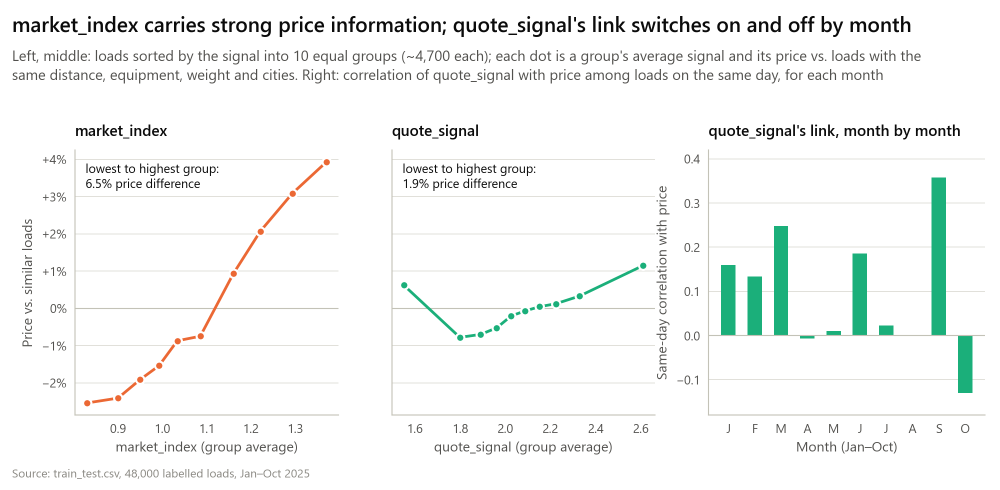
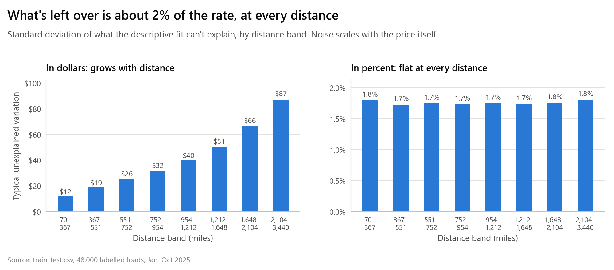
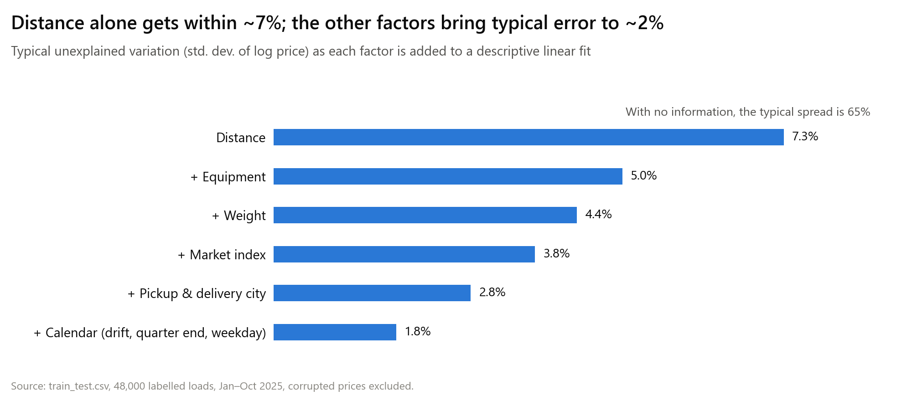
